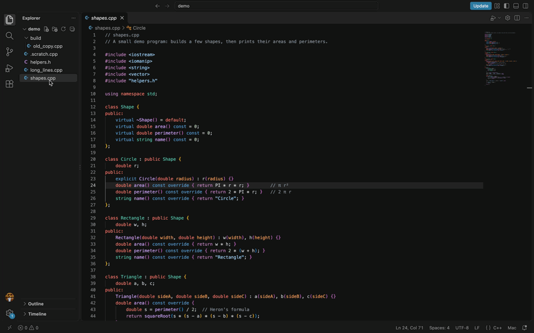
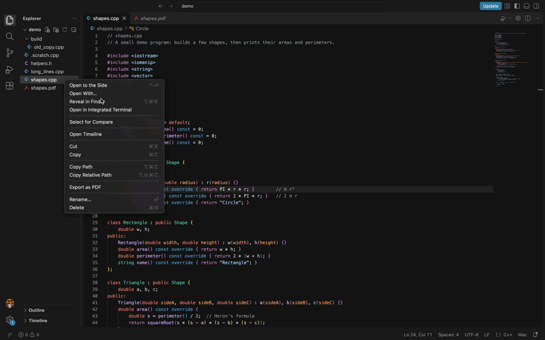
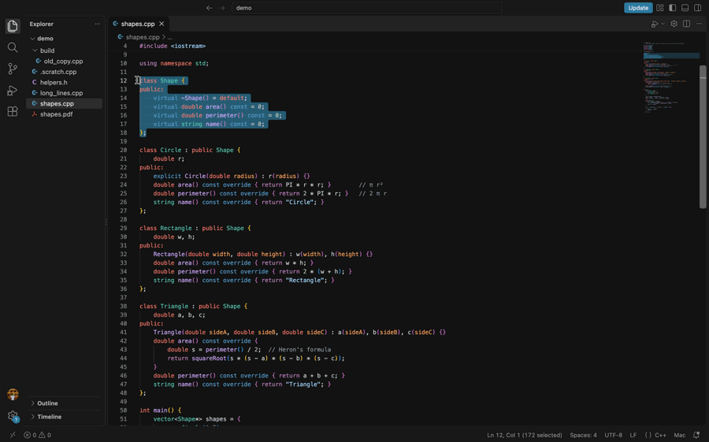
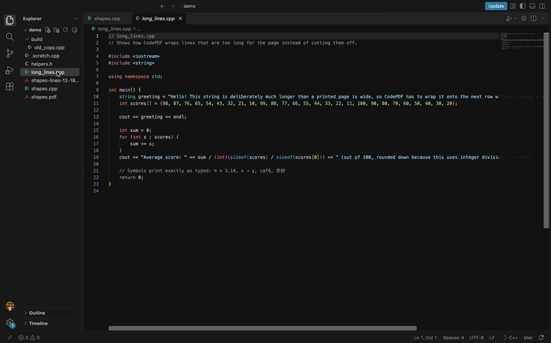
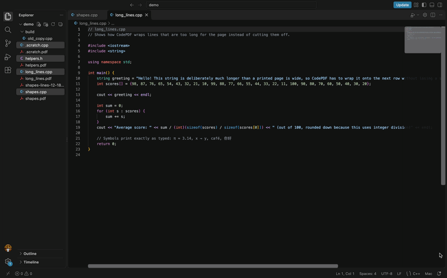
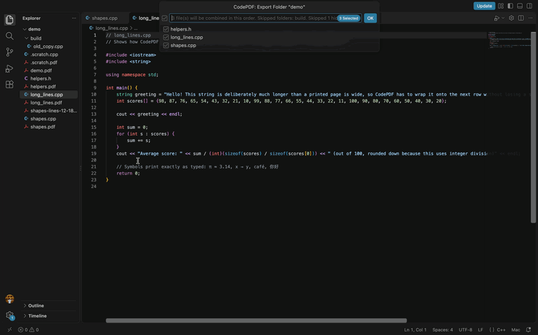
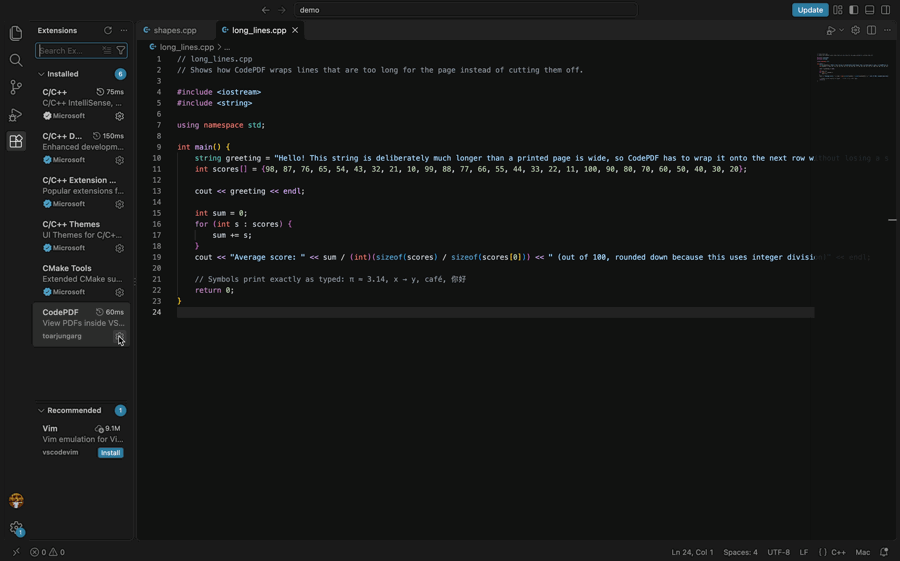

# CodePDF

A VS Code extension that does two things:

1. Opens PDF files in a VS Code tab.
2. Exports C, C++, Python, CSS, HTML, JavaScript, TypeScript, React, Rust, Java, C#, Go, PHP, SQL, Shell, Kotlin, Swift, Ruby, Dart, Lua, R, MATLAB and Arduino files as clean, printable PDFs.

I built it for my own assignments. I wanted to read the assignment PDF next to my code, and then turn my `.cpp` files into PDFs I could upload, without leaving VS Code.

Everything runs on your computer. There is no telemetry, no account and no network access.

## Install

Search for "CodePDF" in the Extensions view in VS Code, or get it from the [VS Code Marketplace](https://marketplace.visualstudio.com/items?itemName=toarjungarg.codepdf).

## Viewing PDFs

Open any `.pdf` file in VS Code and it shows up in a tab.

- Scroll through pages, or type a page number to jump to it
- Zoom in and out, Fit Width and Fit Page
- Search for text (Cmd+F on Mac, Ctrl+F elsewhere)
- Open several PDFs at once
- If the PDF changes on disk, the tab reloads and keeps your place
- Password-protected PDFs ask for the password
- Broken or empty files get a clear message instead of a blank tab

Links inside a PDF never open by themselves. CodePDF asks first, and only opens web and email links.

## Exporting C, C++, Python, CSS, HTML, JavaScript, TypeScript, React, Rust, Java, C#, Go, PHP, SQL, Shell, Kotlin, Swift, Ruby, Dart, Lua, R, MATLAB and Arduino to PDF

Supported files:

- C: `.c`
- C++: `.cpp`, `.cc`, `.cxx`, `.h`, `.hpp`, `.hh`, `.hxx`
- Python: `.py`, `.pyw`
- CSS: `.css`
- HTML: `.html`, `.htm`
- JavaScript: `.js`, `.mjs`, `.cjs`
- TypeScript: `.ts`, `.mts`, `.cts`
- React: `.jsx`, `.tsx`
- Rust: `.rs`
- Java: `.java`
- C#: `.cs`
- Go: `.go`
- PHP: `.php`
- SQL: `.sql`
- Shell / Bash: `.sh`, `.bash`
- Kotlin: `.kt`, `.kts`
- Swift: `.swift`
- Ruby: `.rb`
- Dart: `.dart`
- Lua: `.lua`
- R: `.r`
- MATLAB: `.m`
- Arduino: `.ino`

`.h` files are coloured as C++, which also works for C headers. `.m` files are treated as MATLAB. `.ino` sketches are coloured as C++.

With HTML, CSS and JavaScript, it supports traditional web dev.

I'm adding more languages. Verilog / SystemVerilog is next.

| Command | What it does |
|---|---|
| CodePDF: Export as PDF | Exports one file. `main.cpp` becomes `main.pdf` in the same folder. |
| CodePDF: Export Selection as PDF | Exports only the lines you highlighted, with their real line numbers. |
| CodePDF: Export Multiple Files | Combines the files you pick into one PDF. Each file starts on a new page. |
| CodePDF: Export Folder as PDF | Combines every C, C++, Python, CSS, HTML, JavaScript, TypeScript, React, Rust, Java, C#, Go, PHP, SQL, Shell, Kotlin, Swift, Ruby, Dart, Lua, R, MATLAB and Arduino file in a folder into one PDF. |

You can run them from the Command Palette, or by right-clicking a file or folder in the Explorer, or by right-clicking in the editor.

The PDFs have syntax colours, line numbers, a header with the file name and a footer with the date and "Page X of Y". Long lines wrap onto the next row instead of being cut off. Combined PDFs get a bookmark for each file.

### Export a file



### Asks before replacing a PDF



### Export just the lines you select



### Long lines wrap, nothing gets cut off



### Combine several files into one PDF



### Export a whole folder (skips build folders and hidden files)



The demos show C++ files, but everything works the same way for C, Python, CSS, HTML, JavaScript, TypeScript, React, Rust, Java, C#, Go, PHP, SQL, Shell, Kotlin, Swift, Ruby, Dart, Lua, R, MATLAB and Arduino.

Some details worth knowing:

- Your source files are never changed.
- If the PDF already exists, CodePDF asks before replacing it.
- If a file is open with unsaved changes, the export uses what is on screen and tells you so.
- The PDF uses the same font as your editor (the `editor.fontFamily` setting), as long as it is a monospace font installed on your computer. Otherwise it uses the system's default monospace font.
- Folder export skips hidden files and folders, and folders named `node_modules`, `build`, `builds`, `dist`, `out`, `bin`, `obj`, `debug`, `release`, `x64`, `x86`, `target`, `__pycache__`, `venv`, `vendor`, `pods`, `deriveddata`, `carthage`, `lua_modules`, `renv`, `packrat`, `slprj`, `codegen` or starting with `cmake-build-`. It shows you the file list before exporting, so you can untick anything.
- Folder export stops at 500 files and does not follow shortcuts (symlinks). Header files come first, then the rest in alphabetical order.
- If you export `main.cpp` and `main.h` together as separate PDFs, they are named `main.cpp.pdf` and `main.h.pdf` so one does not overwrite the other.

## Settings

Search for "CodePDF" in VS Code's Settings.



| Setting | Default | Options |
|---|---|---|
| `codepdf.paperSize` | Letter | Letter, A4 |
| `codepdf.orientation` | portrait | portrait, landscape |
| `codepdf.fontSize` | 10 | 6 to 16 points |
| `codepdf.margins` | 0.75 | 0.25 to 2 inches |
| `codepdf.lineNumbers` | on | on, off |
| `codepdf.syntaxHighlighting` | on | on, off |
| `codepdf.header` | on | on, off |
| `codepdf.footer` | on | on, off |
| `codepdf.pageNumbers` | on | on, off |
| `codepdf.lineWrapping` | on | on, off. When off, long lines are cut at the margin and marked with an arrow. |

Tab width follows your editor's tab size.

## Privacy and security

- No telemetry, analytics, ads, accounts or network requests. PDFs are read and written on your computer only.
- The viewer runs in a locked-down webview. Its content security policy blocks all network access, inline scripts, `eval` and WebAssembly. It can only load files from the extension's own folder, and the PDF is passed in as data, so the viewer never gets access to your folders.
- PDF scripting is turned off, and the part of PDF.js that runs scripts inside PDFs is not shipped.
- Your code is only read as text. It is never run, and never passed to a shell.
- To find fonts, CodePDF lists the names of the files in the system font folders and opens the ones that match your editor font.

## Dependencies

All of them come from the npm registry (`https://registry.npmjs.org/`), pinned to exact versions in `package-lock.json`.

Shipped with the extension:

| Package | Version | Licence | What it does |
|---|---|---|---|
| [pdfjs-dist](https://www.npmjs.com/package/pdfjs-dist) (Mozilla PDF.js) | 6.4.299 | Apache-2.0 | Draws PDFs in the viewer. Only the files the viewer needs are copied in at build time. |
| [pdfkit](https://www.npmjs.com/package/pdfkit) | 0.20.2 | MIT | Writes the exported PDF files. |
| [fontkit](https://www.npmjs.com/package/fontkit) | 2.0.4 | MIT | Reads font files, to find the editor font and check which characters it has. |

pdfkit and fontkit bring 16 small helper packages with them (compression, line breaking, PNG reading, encryption, Unicode data). `package-lock.json` lists every one with its version and checksum.

Used only for building and testing, never shipped:

| Package | Version | What it does |
|---|---|---|
| [typescript](https://www.npmjs.com/package/typescript) | 6.0.3 | Compiles the TypeScript source. |
| [@types/vscode](https://www.npmjs.com/package/@types/vscode) | 1.140.0 | Type descriptions for the VS Code API. |
| [@vscode/vsce](https://www.npmjs.com/package/@vscode/vsce) | 4.1.0 | Packages the extension into a `.vsix` file. |

The syntax colouring is written from scratch (`src/export/cFamilyTokenizer.ts` for C and C++, `src/export/pythonTokenizer.ts` for Python, `src/export/cssTokenizer.ts` for CSS, `src/export/htmlTokenizer.ts` for HTML, `src/export/javascriptTokenizer.ts` for JavaScript, TypeScript and React, `src/export/rustTokenizer.ts` for Rust, `src/export/javaTokenizer.ts` for Java, `src/export/csharpTokenizer.ts` for C#, `src/export/goTokenizer.ts` for Go, `src/export/phpTokenizer.ts` for PHP, `src/export/sqlTokenizer.ts` for SQL, `src/export/shellTokenizer.ts` for Shell / Bash, `src/export/kotlinTokenizer.ts` for Kotlin, `src/export/swiftTokenizer.ts` for Swift, `src/export/rubyTokenizer.ts` for Ruby, `src/export/dartTokenizer.ts` for Dart, `src/export/luaTokenizer.ts` for Lua, `src/export/rTokenizer.ts` for R, `src/export/matlabTokenizer.ts` for MATLAB; Arduino sketches use the C++ one), so there is no highlighting library.

Install scripts are turned off for this project (`.npmrc`), and optional binary packages are not installed.

Known issue: `npm audit` reports a moderate issue in `minimatch` 10.2.6, which `@vscode/vsce` uses ([GHSA-g3hv-75wg-m249](https://github.com/advisories/GHSA-g3hv-75wg-m249)). It is counted twice, once for each package. It is a build tool only, it only reads this project's own packaging patterns, and it is not part of the extension.

## Limitations

- Syntax colouring is for C, C++, Python, CSS, HTML, JavaScript, TypeScript, React, Rust, Java, C#, Go, PHP, SQL, Shell, Kotlin, Swift, Ruby, Dart, Lua, R, MATLAB and Arduino only, and it is pattern-based rather than a full parser, so unusual macros can be coloured slightly wrong. The text itself is always exact.
- In Python, `match`, `case` and `type` are only coloured as keywords when the statement fits on one line.
- In JavaScript, a `/` right after `)` is read as division, so a regex there (like `if (ok) /a/.test(s)`) isn't coloured.
- In TypeScript, type words like `string` and `number` are always coloured as types, even when used as a variable name.
- In Rust, only built-in types and common standard ones (like `String`, `Vec` and `Option`) are coloured as types. Your own structs and enums stay plain.
- In Java, any name that starts with a capital letter and isn't in all capitals is coloured as a type, following Java's naming convention. A variable named like a class gets coloured too.
- In C#, a name is coloured as a type if it's a common .NET type (like `List` or `Task`), a type declared in the same file, or the name right after `new`. Types from other files stay plain elsewhere.
- In Go, a name is coloured as a type if it's a built-in type (like `int` or `error`) or a type declared with `type` in the same file. Types from other files and packages stay plain. Built-in functions like `len` and `max` are only coloured when they are called, so a variable named `max` stays plain.
- In PHP, text outside `<?php` and `?>` is left plain, and a name is coloured as a class if it comes after `new`, `extends`, `implements`, `instanceof` or `use`, before `::`, or before a `$variable` or as a return type. Other class names stay plain. Variables are not coloured, and inside a double-quoted string or heredoc, the `$variable` and `{$expression}` parts are shown plain instead of as code.
- In SQL, words are coloured the same in every database, so a column or table named like a keyword or type (like `key`, `date` or `text`) is coloured too, unless it is in quotes or comes after a dot. Built-in functions like `count` and `max` are only coloured when a bracket follows. In MySQL, a `\'` inside a string isn't treated as an escape (use `''` instead), except in `E'...'` strings. A `#` starts a comment only at the start of a line or after a space, and block comments do not nest.
- In Shell / Bash, `.sh` and `.bash` files are coloured the same way, and other shells like `.zsh` are not supported. A word like `if`, `then` or `echo` is only coloured where a command can start, so it is left plain as an argument (`echo if`). Only the common builtins are coloured, so commands like `grep` and `ls` stay plain. Heredoc bodies are always one string colour, even when they contain `$variables`. A `<<` right before a word is read as a heredoc, so shifting bits like `1<<n` should be written inside `$(( ))`.
- In Kotlin, `.kt` and `.kts` files are coloured the same way. A name is coloured as a type if it starts with a capital letter and has a lowercase letter somewhere (`String`, `Point`), so a class named in capitals like `HTTP` stays plain. Words like `data`, `sealed`, `override`, `value`, `get`, `set`, `by` and `where` are only coloured where they work as keywords, so a variable named `data` or `value` stays plain, but a modifier split from its declaration over two lines is not coloured. A function type like `suspend () -> Unit` is only coloured when it follows a `:`, `<`, `,`, `(` or `=`. The `@label` part of `return@forEach` or `this@Outer` stays plain. Inside a string, `$name` and the braces of `${...}` are shown plain, and the code between the braces is coloured as code.
- In Swift, a name is coloured as a type if it starts with a capital letter (`String`, `URL`, `Point`), so a capitalised constant is coloured as a type too. Words like `get`, `set`, `willSet`, `didSet`, `some`, `any`, `async`, `await`, `actor`, `final`, `lazy` and `open` are only coloured where they work as keywords, so a variable named `get` or `some` stays plain, but a modifier split from its declaration over two lines is not coloured. A keyword right after a dot (like `.default` or `.none`) is shown plain, except `.self` and `.init`. Inside a string, the `\(` and `)` around interpolated code are shown plain, and the code between them is coloured as code. Regex literals (`/.../` and `#/.../#`) are not recognised, so a `/` is always read as an operator and the pattern is coloured like normal code.
- In Ruby, only `.rb` files are supported, so files like `Gemfile`, `Rakefile` and `.erb` templates are not. A name is coloured as a type if it starts with a capital letter, so constants like `MAX_SIZE` are coloured as types, and `@name`, `@@name` and `$name` variables get the same colour. Symbols (`:name`, `:+`) and hash labels (`name:`) use the number colour, and a quoted symbol like `:"two words"` is coloured as a string. A `/`, `%` or `<<` is only read as a regex, a `%w[]` style literal or a heredoc where a value can start (after an operator, a bracket, a comma, a keyword or at the start of a line, or after a method name with a space before it and none after it), so `a << b` and `a / b` stay plain. A regex right after a method name (like `split /,/`) is only coloured when its closing `/` is on the same line. A heredoc is only recognised when its closing tag really shows up on a line later in the file. Heredoc bodies are always one string colour, even when they contain `#{code}`, and `#@name` style interpolation is shown as plain string text. Words like `puts`, `require`, `include`, `attr_accessor`, `private` and `raise` are coloured as keywords, but other methods are not, and a keyword right after a dot (like `x.class`) or after `def` is shown plain. A `?a` character literal is only coloured where a value can start, and a ternary with no spaces (like `a ?b:c`) may be coloured slightly wrong.
- In Dart, a name is coloured as a type if it starts with a capital letter (after any `_`) and has a lowercase letter somewhere (`String`, `Point`, `_State`), so a class named in capitals like `HTTP` stays plain. The built-in types `int`, `double`, `num`, `bool`, `dynamic` and `void` are coloured as keywords, like in the other languages. Words like `get`, `set`, `operator`, `late`, `required`, `sealed`, `base`, `interface`, `mixin`, `extension`, `on`, `show`, `hide`, `async`, `await`, `yield` and `when` are only coloured where they work as keywords, so a variable named `get` or `base` stays plain, but a modifier split from its declaration over two lines is not coloured. A word right after a dot (like `x.static` or `Foo.new`) and a named argument (like `required: true`) are shown plain. `async` is only coloured right after a `)`, and `when` only after a pattern, so a `when` guard that starts its own line is plain. Inside a string, `$name` and the `${` and `}` around interpolated code are shown plain, and the code between the braces is coloured as code. Symbols like `#name` and `#+` use the number colour. A number with an underscore, like `1_000`, is coloured as one number.
- In Lua, only `.lua` files are supported. Built-in functions like `print`, `pairs`, `require` and `setmetatable` are only coloured when they are called (a bracket, a string or a table follows), and library names like `string`, `table` and `math` only when a dot follows, so a variable named `type` or `table` stays plain. A name right after a dot or colon (like `t.print` or `obj:type()`) is shown plain, and so are the names in a `local` list and after `local function`. Names are never coloured as types, apart from `_G`, `_ENV` and `_VERSION`. A label (`::continue::`) and the name after `goto` share one colour, and `<const>` and `<close>` are coloured only right after a `local` name.
- In R, only `.r` and `.R` files are supported, so `.Rmd` notebooks and `.Rprofile` are not. Common built-in functions like `print`, `paste`, `library`, `c` and `sapply` are only coloured when they are called (a bracket follows), so a variable named `names` or `table` stays plain, and functions from packages (like `filter` from dplyr) are plain. A name right before `::` is coloured as a type (a package name), and a name after `$`, `@` or `::` is always plain. Backtick names (`` `my var` ``) are plain, even if they match a keyword. Every `%...%` operator (`%in%`, `%>%`, `%%`) is read as one piece, so it has to close on the same line. A number like `1L`, `2i` or `0x1F` is coloured as one number. The constants `TRUE`, `FALSE`, `NULL`, `Inf`, `NaN` and the `NA` family use the keyword colour, but `T` and `F` stay plain.
- In MATLAB, only `.m` files are supported, so `.mlx` live scripts and `.mat` data files are not, and every `.m` file is read as MATLAB (Objective-C `.m` files are not supported). Command syntax (like `hold on` or `format long`) is not understood, so those words are plain. Common built-in functions like `zeros`, `size`, `disp`, `fprintf` and `plot` are only coloured when they are called (a bracket right after the name), so a variable named `size` or `max` stays plain, and the loop names `i` and `j` are plain too. A name after a dot (like `s.end` or `obj.size`) is always plain, and so are the names in a `function` line, even if they match a built-in. A `'` is read as a transpose right after a name, a number, a closing bracket or another transpose with no space in between, and as the start of a string everywhere else, so `a '` is a string, and a quote right after a keyword like `case` starts a string. An `end` inside brackets (like `x(end)'`) counts as an index, but an unclosed bracket can make a later `end` be read the wrong way. `properties`, `methods`, `events` and `enumeration` are only coloured as keywords when they are alone on a line in a file that has a `classdef`, and `arguments` only when it is alone on its line. A string stops at the end of its line, and backslashes are not escapes, as in MATLAB. A `%{` or `%}` has to be alone on its line to count as a block comment. The rest of a line after `...` is coloured as a comment.
- In Arduino, only `.ino` sketches are supported (not the old `.pde`). They are coloured as C++, so Arduino names like `setup`, `loop`, `pinMode`, `digitalWrite`, `Serial`, `HIGH` and `LED_BUILTIN` are plain, not coloured as built-ins.
- Since `.h` files are coloured as C++, a C header that uses a C++ word like `new` or `class` as a name shows that word coloured as a keyword.
- Emoji are not supported in exported PDFs. They print as a placeholder symbol.
- Characters your editor font does not have (for example Chinese, Japanese or Korean) are filled in from a system font.
- The viewer is read-only. It cannot edit, annotate, fill in forms or print.
- PDFs over 300 MB are refused. So are source files over 10 MB, unless the file is already open in the editor.

## Building it yourself

You need Node.js and VS Code 1.140 or newer.

```sh
npm ci --omit=optional   # install the exact pinned dependencies
npm test                 # build, then run the unit tests
npm run test:vscode      # run the tests inside VS Code (macOS, uses a separate test profile)
npm run package          # build codepdf-<version>.vsix
```

To install the `.vsix`: open the Extensions view in VS Code, click the `...` menu at the top, choose "Install from VSIX..." and pick the file.

## Licence

MIT. See [LICENSE](LICENSE). The bundled PDF.js files keep their own Apache-2.0 licence, which is included in `media/pdfjs/`.
