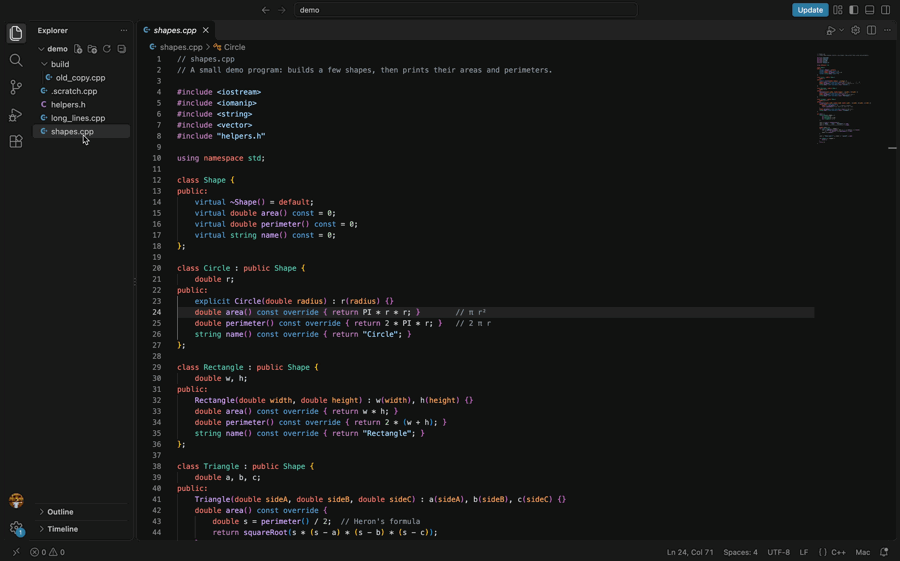
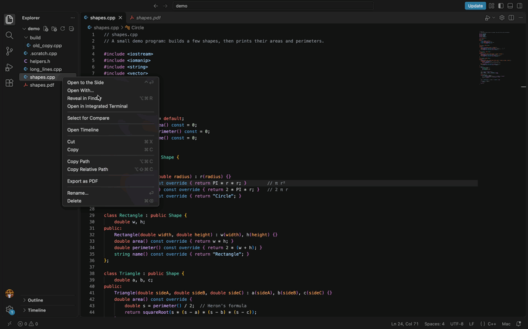
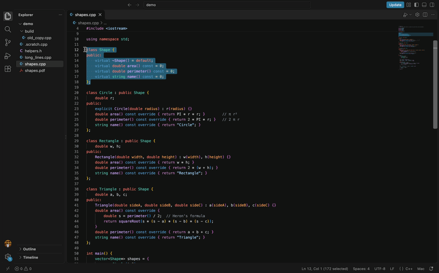
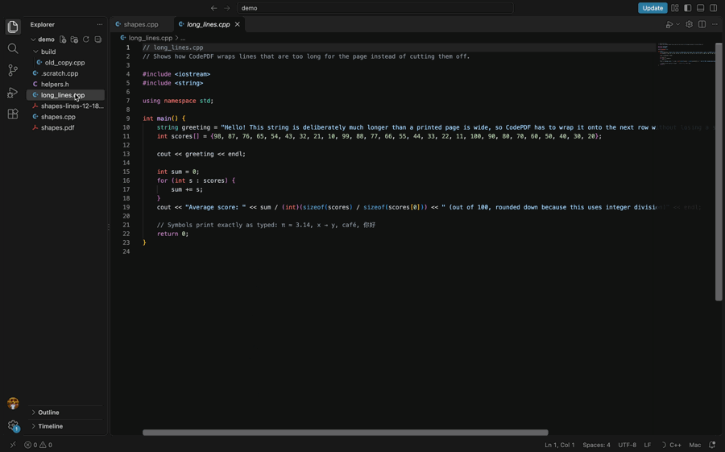
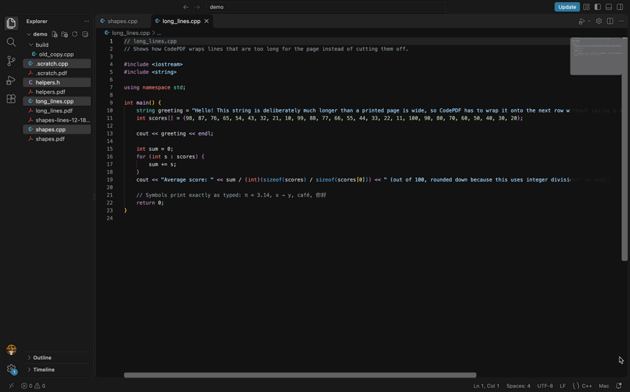
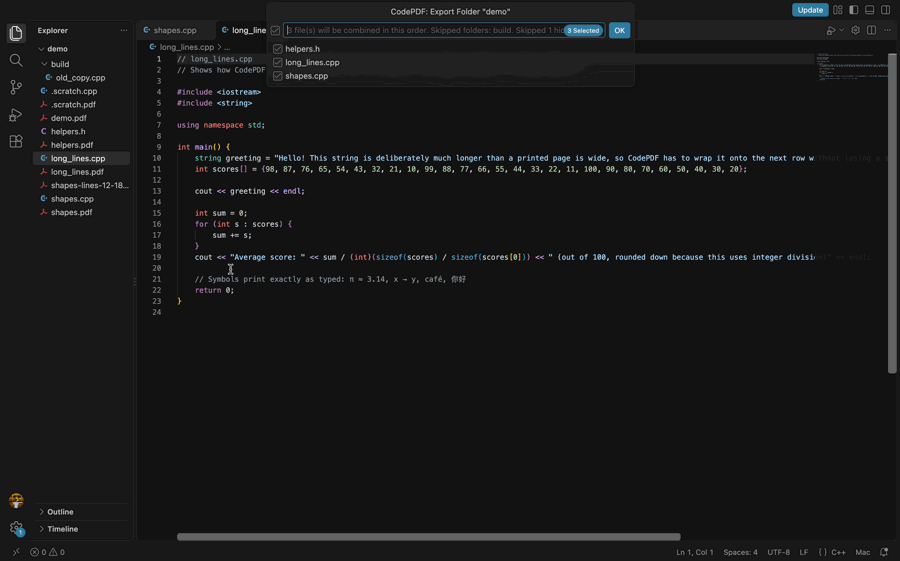
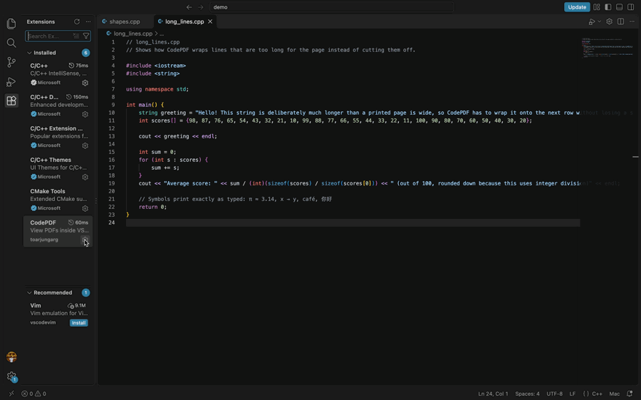

# CodePDF

A VS Code extension that does two things:

1. Opens PDF files in a VS Code tab.
2. Exports C++ files as clean, printable PDFs.

I built it for my own assignments. I wanted to read the assignment PDF next to my code, and then turn my `.cpp` files into PDFs I could upload, without leaving VS Code.

Everything runs on your computer. There is no telemetry, no account and no network access.

## Viewing PDFs

Open any `.pdf` file in VS Code and it shows up in a tab.

- Scroll through pages, or type a page number to jump to it
- Zoom in and out, Fit Width and Fit Page
- Search for text (Cmd+F on Mac, Ctrl+F elsewhere)
- Open several PDFs at once
- If the PDF changes on disk, the tab reloads and keeps your place
- Broken, empty or password-protected files get a clear message instead of a blank tab

Links inside a PDF never open by themselves. CodePDF asks first, and only opens web and email links.

## Exporting C++ to PDF

Supported files: `.cpp`, `.cc`, `.cxx`, `.h`, `.hpp`, `.hh`, `.hxx`

| Command | What it does |
|---|---|
| CodePDF: Export as PDF | Exports one file. `main.cpp` becomes `main.pdf` in the same folder. |
| CodePDF: Export Selection as PDF | Exports only the lines you highlighted, with their real line numbers. |
| CodePDF: Export Multiple Files | Combines the files you pick into one PDF. Each file starts on a new page. |
| CodePDF: Export Folder as PDF | Combines every C++ file in a folder into one PDF. |

You can run them from the Command Palette, or by right-clicking a file or folder in the Explorer, or by right-clicking in the editor.

The PDFs have syntax colours, line numbers, a header with the file name and a footer with the date and "Page X of Y". Long lines wrap onto the next row instead of being cut off. Combined PDFs get a bookmark for each file.

### Export a file



### Asks before replacing a PDF



### Export just the lines you select



### Long lines wrap, nothing gets cut off



### Combine several files into one PDF



### Export a whole folder (skips build folders and hidden files)



Some details worth knowing:

- Your source files are never changed.
- If the PDF already exists, CodePDF asks before replacing it.
- If a file is open with unsaved changes, the export uses what is on screen and tells you so.
- The PDF uses the same font as your editor (the `editor.fontFamily` setting), as long as it is a monospace font installed on your computer. Otherwise it uses the system's default monospace font.
- Folder export skips hidden files and folders, and folders named `node_modules`, `build`, `builds`, `dist`, `out`, `bin`, `obj`, `debug`, `release`, `x64`, `x86`, `target` or starting with `cmake-build-`. It shows you the file list before exporting, so you can untick anything.
- If you export `main.cpp` and `main.h` together as separate PDFs, they are named `main.cpp.pdf` and `main.h.pdf` so one does not overwrite the other.

## Settings

Search for "CodePDF" in VS Code's Settings.



| Setting | Default | Options |
|---|---|---|
| `codepdf.paperSize` | Letter | Letter, A4 |
| `codepdf.orientation` | portrait | portrait, landscape |
| `codepdf.fontSize` | 10 | 6 to 16 points |
| `codepdf.margins` | 0.75 | 0.25 to 2 inches |
| `codepdf.lineNumbers` | on | on, off |
| `codepdf.syntaxHighlighting` | on | on, off |
| `codepdf.header` | on | on, off |
| `codepdf.footer` | on | on, off |
| `codepdf.pageNumbers` | on | on, off |
| `codepdf.lineWrapping` | on | on, off. When off, long lines are cut at the margin and marked with an arrow. |

Tab width follows your editor's tab size.

## Privacy and security

- No telemetry, analytics, ads, accounts or network requests. PDFs are read and written on your computer only.
- The viewer runs in a locked-down webview. Its content security policy blocks all network access, inline scripts, `eval` and WebAssembly. It can only load files from the extension's own folder, and the PDF is passed in as data, so the viewer never gets access to your folders.
- PDF scripting is turned off, and the part of PDF.js that runs scripts inside PDFs is not shipped.
- Your code is only read as text. It is never run, and never passed to a shell.
- To find fonts, CodePDF lists the names of the files in the system font folders and opens the ones that match your editor font.

## Dependencies

All of them come from the npm registry (`https://registry.npmjs.org/`), pinned to exact versions in `package-lock.json`.

Shipped with the extension:

| Package | Version | Licence | What it does |
|---|---|---|---|
| [pdfjs-dist](https://www.npmjs.com/package/pdfjs-dist) (Mozilla PDF.js) | 6.4.299 | Apache-2.0 | Draws PDFs in the viewer. Only the files the viewer needs are copied in at build time. |
| [pdfkit](https://www.npmjs.com/package/pdfkit) | 0.20.2 | MIT | Writes the exported PDF files. |
| [fontkit](https://www.npmjs.com/package/fontkit) | 2.0.4 | MIT | Reads font files, to find the editor font and check which characters it has. |

pdfkit and fontkit bring 16 small helper packages with them (compression, line breaking, PNG reading, encryption, Unicode data). `package-lock.json` lists every one with its version and checksum.

Used only for building and testing, never shipped:

| Package | Version | What it does |
|---|---|---|
| [typescript](https://www.npmjs.com/package/typescript) | 6.0.3 | Compiles the TypeScript source. |
| [@types/vscode](https://www.npmjs.com/package/@types/vscode) | 1.140.0 | Type descriptions for the VS Code API. |
| [@vscode/vsce](https://www.npmjs.com/package/@vscode/vsce) | 4.1.0 | Packages the extension into a `.vsix` file. |

The C++ syntax colouring is written from scratch in `src/export/cppTokenizer.ts`, so there is no highlighting library.

Install scripts are turned off for this project (`.npmrc`), and optional binary packages are not installed.

Known issue: `npm audit` reports one moderate issue in `minimatch` 10.2.6, which `@vscode/vsce` uses ([GHSA-g3hv-75wg-m249](https://github.com/advisories/GHSA-g3hv-75wg-m249)). It is a build tool only, it only reads this project's own packaging patterns, and it is not part of the extension.

## Limitations

- Syntax colouring is for C++ only, and it is pattern-based rather than a full parser, so unusual macros can be coloured slightly wrong. The text itself is always exact.
- Emoji are not supported in exported PDFs.
- Characters your editor font does not have (for example Chinese, Japanese or Korean) are filled in from a system font. This is tested on macOS. On Windows and Linux the font lookup is written but not tested yet.
- The viewer is read-only. It cannot edit, annotate, fill in forms or print.
- PDFs over 300 MB and source files over 10 MB are refused.

## Building it yourself

You need Node.js and VS Code 1.140 or newer.

```sh
npm ci --omit=optional   # install the exact pinned dependencies
npm test                 # build, then run the unit tests
npm run test:vscode      # run the tests inside VS Code (macOS, uses a separate test profile)
npm run package          # build codepdf-<version>.vsix
```

To install the `.vsix`: open the Extensions view in VS Code, click the `...` menu at the top, choose "Install from VSIX..." and pick the file.

## Licence

MIT. See [LICENSE](LICENSE). The bundled PDF.js files keep their own Apache-2.0 licence, which is included in `media/pdfjs/`.
